 

## ⚡ ABOUT

<b>🧬 &nbsp;Expand: Identity Matrix</b>

 

| Field | Value |
|:--|:--|
| 👑 **Alias** | Ghost King |
| 🏢 **Org** | OLZY Corporation |
| 🌍 **Location** | Earth (UTC +05:30) |
| 🎯 **Focus** | *(edit me — e.g. AI, security, full-stack)* |
| 🔭 **Currently building** | *(edit me)* |
| 🌱 **Learning** | *(edit me)* |
| 💬 **Ask me about** | *(edit me)* |

## 🛰️ ARSENAL

<b>🔧 &nbsp;Expand: Full loadout</b>

 

- **Languages** — Python · JavaScript · TypeScript · Bash
- **Frontend** — React · HTML · CSS
- **Backend / Ops** — Node.js · Docker · Linux
- **Tools** — Git · VS Code

> ✏️ Swap the icon IDs above for your real stack: https://skillicons.dev

## 🚀 PROJECTS

<b>📡 &nbsp;Mission Log</b>

 

| Codename | Description | Stack | Status |
|:--|:--|:--|:--:|
| **PROJECT-01** | Your first big thing goes here | `Python` | 🟡 |
| **PROJECT-02** | Another classified build | `React` | 🔵 |
| **PROJECT-03** | Coming soon… | `—` | ⚫ |

🟢 shipped · 🟡 in progress · 🔵 planned · ⚫ redacted

*Once you have public repos, pin them on your profile and they'll show up automatically.*

## 📊 STATS

 

### 🐍 Contribution Snake

<picture>
  <source media="(prefers-color-scheme: dark)" srcset="https://raw.githubusercontent.com/rexumbrae369/rexumbrae369/output/snake-dark.svg"/>
  
</picture>

## 📬 CONNECT

<!-- Uncomment and edit what you use:

-->

 

`// signal lost. ghost king out.`

